# NoSQL — Завдання 3: граф знань для рекомендаційної системи

Рекомендаційний рушій на графовій базі даних [Neo4j](https://neo4j.com/):
проєктування схеми, завантаження датасету
[MovieLens 1M](https://grouplens.org/datasets/movielens/1m/) (6 040 користувачів,
3 883 фільми, 1 000 209 оцінок), Cypher-запити від фільтрацій до рекомендацій і пошуку
шляхів, аналіз супервузлів, алгоритми Graph Data Science (PageRank, Louvain, Dijkstra)
і порівняння графової моделі з реляційною.

## Зміст

- [Структура](#структура)
- [Налаштування і запуск](#налаштування-і-запуск)
- [Частина 1 — проєктування схеми](#частина-1--проєктування-схеми)
- [Частина 2 — завантаження даних](#частина-2--завантаження-даних)
- [Частина 3 — запити різної складності](#частина-3--запити-різної-складності)
- [Частина 4 — виявлення супервузлів](#частина-4--виявлення-супервузлів)
- [Частина 5 — графові алгоритми через GDS (додаткова)](#частина-5--графові-алгоритми-через-gds-додаткова)
- [Частина 6 — аналіз і висновки](#частина-6--аналіз-і-висновки)

## Структура

```
.
├── docker-compose.yml            # локальний запуск Neo4j з APOC і GDS
├── convert.py                    # конвертація .dat → .csv
├── data/                         # ml-1m.zip і розпаковані .dat (не комітиться)
├── import/                       # CSV для LOAD CSV (не комітяться, див. нижче)
│   ├── movies.csv
│   ├── users.csv
│   └── ratings.csv
├── queries/
│   ├── part2_load.cypher         # обмеження, індекси, завантаження даних
│   ├── part3.cypher              # шість запитів частини 3
│   ├── part4_supernodes.cypher   # супервузли
│   ├── part5_gds.cypher          # PageRank, Louvain, Dijkstra (додаткова частина)
│   └── part6_improvements.cypher # експерименти зі схемою для частин 4 і 6
├── screenshots/                  # скриншоти з Neo4j Browser
├── pyproject.toml, uv.lock, .python-version
└── README.md
```

## Налаштування і запуск

Потрібні Docker і Python 3.12+ (скрипт `convert.py` використовує лише стандартну бібліотеку;
у проєкті є `pyproject.toml` для [uv](https://docs.astral.sh/uv/), але підійде і звичайний `python3`).

```bash
# 1. Датасет: завантажити й розпакувати в data/
mkdir -p data
curl -L -o data/ml-1m.zip https://files.grouplens.org/datasets/movielens/ml-1m.zip
unzip data/ml-1m.zip -d data      # → data/ml-1m/{movies,users,ratings}.dat і README

# 2. Конвертація .dat → .csv (результат у import/)
uv run python convert.py          # або: python3 convert.py

# 3. Neo4j (чекає, доки контейнер стане healthy)
docker compose up -d --wait

# 4. Завантаження даних і запити
docker exec -i neo4j_movielens cypher-shell -u neo4j -p password123 < queries/part2_load.cypher
docker exec -i neo4j_movielens cypher-shell -u neo4j -p password123 < queries/part3.cypher
docker exec -i neo4j_movielens cypher-shell -u neo4j -p password123 --format verbose < queries/part4_supernodes.cypher
docker exec -i neo4j_movielens cypher-shell -u neo4j -p password123 --format verbose < queries/part5_gds.cypher
docker exec -i neo4j_movielens cypher-shell -u neo4j -p password123 --format verbose < queries/part6_improvements.cypher
```

Neo4j Browser: <http://localhost:7474>, логін `neo4j`, пароль `password123`.
Зупинити: `docker compose down` (дані лишаються в томі) або `docker compose down -v` (з видаленням даних).

### Відхилення від шаблону завдання

- **Версії.** Замість `neo4j:5.18-community` використано останній на момент виконання
  реліз `neo4j:2026.10.2-community` з APOC 2026.10.2 і GDS 2026.10.2. Усі скрипти
  перевірено повним запуском із чистого тому. Що це змінило:
  - мова запитів за замовчуванням — Cypher 25, тому в запитах використано сучасний синтаксис
    (`COUNT { ... }`, `EXISTS { ... }`, `CALL (x) { ... }`, динамічні мітки `SET n:$(...)`);
  - функція `id()` із шаблонів частини 5 позначена як застаріла — замінена на `elementId()`
    або порівняння бізнес-ключів (`userId`, `movieId`);
  - `apoc.periodic.iterate` теж позначена як застаріла (рекомендована заміна —
    `CALL { ... } IN TRANSACTIONS`). У завантаженні оцінок її залишено, бо цього прямо вимагає
    завдання; рідний еквівалент наведено в [частині 2](#4-ребра-rated--батчами);
  - параметри пам'яті названо по-новому: `server.memory.heap.*`. Старі назви
    `dbms.memory.heap.*` із завдання Neo4j 2026.10 ще приймає і сам переводить у нові (перевірено).
- **`docker-compose.yml`.** Порти прив'язано до `127.0.0.1` (база з простим паролем не має
  слухати всі інтерфейси), додано `healthcheck`, щоб працював `docker compose up -d --wait`.
- **CSV не комітяться.** У завданні каталог `import/` з CSV показано в репозиторії, але ліцензія
  MovieLens 1M (файл `README` в архіві) прямо забороняє поширювати дані без окремого дозволу:
  *«The user may not redistribute the data without separate permission»*. Тому в публічний
  репозиторій не потрапляють ні `.dat`, ні похідні від них CSV — вони відтворюються кроками 1–2
  за кілька секунд.
- **`convert.py`** крім зміни роздільника й кодування виносить рік із назви фільму в окрему
  колонку та розшифровує коди вікової групи і професії (див. [частину 2](#підготовка-файлів)).
- **Додатковий файл** `queries/part6_improvements.cypher` — вимірювання, на які спираються
  відповіді частин 4 і 6.

## Частина 1 — проєктування схеми

### Схема

```
┌───────────────────────┐                               ┌──────────────────────┐                 ┌──────────────────┐
│ :User                 │                               │ :Movie               │                 │ :Genre           │
│───────────────────────│  [:RATED {rating, timestamp}] │──────────────────────│   [:HAS_GENRE]  │──────────────────│
│ userId    (унікальний)│ ────────────────────────────► │ movieId  (унікальний)│ ──────────────► │ name (унікальний)│
│ gender     "F" | "M"  │        1 000 209 ребер        │ title    (індекс)    │   6 408 ребер   │                  │
│ age        1,18,…,56  │                               │ year                 │                 │    18 вузлів     │
│ ageGroup   "25-34"    │                               │                      │                 │                  │
│ occupation "writer"   │                               │     3 883 вузли      │                 │                  │
│      6 040 вузлів     │                               │                      │                 │                  │
└───────────────────────┘                               └──────────────────────┘                 └──────────────────┘
```

Те саме з Neo4j Browser (`CALL db.schema.visualization()`):

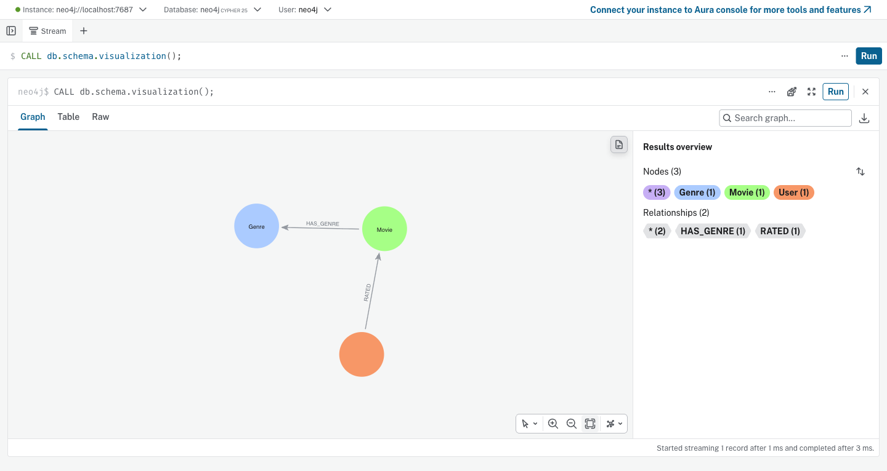

| Елемент | Властивості | Примітки |
|---|---|---|
| `(:User)` | `userId` (int, унікальний), `gender`, `age` (int — код вікової групи з датасету, він же її нижня межа), `ageGroup` (підпис групи), `occupation` (назва професії) | поштовий індекс відкинуто |
| `(:Movie)` | `movieId` (int, унікальний), `title` (без року), `year` (int) | рік винесено з назви `"Toy Story (1995)"` |
| `(:Genre)` | `name` (унікальний) | 18 жанрів |
| `(:User)-[:RATED]->(:Movie)` | `rating` (int 1–5), `timestamp` (int, Unix-час у секундах) | напрямок «хто → що оцінив» |
| `(:Movie)-[:HAS_GENRE]->(:Genre)` | — | фільм має від 1 до 6 жанрів |

### 1. Які сутності стали вузлами, а які — ребрами? Чому?

**Вузли — `User`, `Movie`, `Genre`.** Це об'єкти з власною ідентичністю, з яких запити
починають обхід або через які проходять: «фільми жанру X», «що оцінив користувач Y»,
«хто ще оцінив цей фільм». Кожен із них пов'язаний із багатьма іншими об'єктами, і саме ці
зв'язки — предмет аналізу.

**Ребра — `RATED` і `HAS_GENRE`.** Це факти про пару об'єктів: «користувач оцінив фільм»
(з властивостями самого факту — оцінка і час) та «фільм належить до жанру». Власної
ідентичності в них немає, і без обох кінців вони не існують.

**Властивості, а не вузли — стать, вікова група, професія, рік.** Це атрибути з малою кількістю
значень, які потрібні для фільтрації та показу, а не для обходу. Якби зробити їх вузлами,
вийшли б супервузли без користі: до вузла `(:Gender {value: 'M'})` було б підключено
4 331 користувача, до вікової групи «25-34» — 2 096. Шлях «два користувачі однієї статі»
нічого не каже про схожість смаків, зате з'єднав би майже всіх з усіма за два кроки і зіпсував би
і рекомендації, і пошук найкоротших шляхів. Правило, яким я керувався: атрибут стає вузлом
тоді, коли через нього треба *ходити* або за ним треба *групувати сусідів*; жанр цю умову
виконує (запити 1 і 4), стать і вік — ні.

### 2. Оцінка — ребро `(User)-[:RATED]->(Movie)` чи вузол `(Rating)`?

Обрано **ребро**.

Аргументи за ребро:

- **Оцінка не має власної ідентичності.** У датасеті пара (користувач, фільм) унікальна:
  серед 1 000 209 рядків `ratings.dat` немає жодної повторної пари (перевірено і в сирих даних,
  і запитом після завантаження). Це точна семантика ребра — один факт про двох учасників.
- **Коротші обходи.** Головний патерн рекомендацій `(User)-[:RATED]->(Movie)<-[:RATED]-(User)`
  займає 2 кроки. З вузлом `Rating` той самий зв'язок — це
  `(User)-[:GAVE]->(Rating)-[:FOR]->(Movie)<-[:FOR]-(Rating)<-[:GAVE]-(User)`, тобто 4 кроки:
  удвічі більше звернень до сховища в кожному запиті частини 3 і вдвічі довші шляхи в запиті 6.
- **Менший граф.** 1 млн ребер із двома властивостями проти 1 млн додаткових вузлів і 2 млн ребер.
- **Простіша аналітика.** Граф User–Movie лишається двочастковим, і проєкції GDS та запити
  на спільні оцінки будуються напряму.

Чим за це заплачено (коли вузол `Rating` був би кращим):

- **Ребро з'єднує рівно два вузли.** До оцінки-ребра не можна нічого приєднати: текст рецензії
  з коментарями, пристрій чи сеанс, теги, «ця оцінка корисна» від інших користувачів. Щойно
  оцінка сама стає учасником зв'язків, її доведеться перетворити на вузол.
- **Історія оцінок.** Якщо користувач може переоцінити фільм і історію треба зберігати, то це
  кілька фактів на одну пару. Паралельні ребра можливі, але незручні; вузли `Rating`
  з ланцюжком версій природніші.
- **Фільтр за властивістю ребра читає всі ребра вузла.** Щоб знайти оцінки «1» у популярного
  фільму, треба прочитати властивість кожного з тисяч його ребер (це виміряно в
  [частині 4](#2-чому-запит-через-супервузол-повільніший)). Вузол `Rating` цього не лікує,
  а лікує окремий тип ребра — про це в [частині 6](#3-покращення-схеми).

У MovieLens 1M оцінка — це просте «користувач поставив фільму N балів у момент T» без власних
зв'язків, тому ребро тут і точніше, і швидше.

### 3. Чому жанри вигідніше зберігати як вузли `(Genre)`, а не як список у властивості `Movie`?

- **Обхід від жанру — це перехід за вказівниками, а не перебір усіх фільмів.** Запит
  «фільми жанру Thriller» знаходить один вузол `Genre` за індексом і переходить за 492 його
  ребрами. Зі списком у властивості довелося б перебрати всі 3 883 фільми і для кожного
  перевірити `'Thriller' IN m.genres` — звичайний індекс за елементом списку не шукає.
- **Групування за жанром — це групування за вузлом.** Запит 4 (статистика жанрів) просто
  агрегує сусідів кожного вузла `Genre`; зі списком потрібен `UNWIND` для кожного фільму.
- **Одне джерело правди.** Назва жанру зберігається один раз: немає розбіжностей на кшталт
  `Sci-Fi` / `SciFi`, перейменування — це зміна однієї властивості, а обмеження унікальності
  не дає створити дубль.
- **Жанр може мати власні властивості та зв'язки** — опис, ієрархію піджанрів, «споріднені
  жанри» — без зміни фільмів.
- **Спільний жанр стає шляхом у графі**: `(m1)-[:HAS_GENRE]->(g)<-[:HAS_GENRE]-(m2)`.
  На цьому будуються контентні рекомендації («інші фільми улюблених жанрів користувача»).
- **Кількість фільмів жанру відома без підрахунку** — це ступінь вузла `Genre`.

Ціна: вузли популярних жанрів стають дуже «щільними» (Drama — 1 603 фільми, 41% усіх),
і ходити *крізь* них не можна — це розібрано в
[частині 4](#3-стратегія-для-цього-датасету). Для показу «фільм і його жанри» список
у властивості дешевший (без переходу), тому в навантаженій системі варто мати обидва подання:
вузли для обходів і денормалізовану копію для читання.

## Частина 2 — завантаження даних

Усі запити — у [`queries/part2_load.cypher`](queries/part2_load.cypher).

### Підготовка файлів

`LOAD CSV` приймає лише односимвольний роздільник і очікує UTF-8, а файли MovieLens
використовують `::` і Latin-1, тому [`convert.py`](convert.py) перетворює їх у звичайні CSV.
Запис іде через `csv.writer`, який бере в лапки назви з комами (таких 993, наприклад
`"American President, The"`). Порівняно з шаблоном із завдання скрипт додатково:

- виносить рік із назви в колонку `year` (усі 3 883 назви закінчуються на `(РРРР)`),
  щоб рік був числом, за яким можна фільтрувати й сортувати;
- розшифровує коди вікової групи і професії за таблицями з `README` датасету
  (`25` → `25-34`, `12` → `programmer`) — результати запитів читаються без довідника;
- читає з `data/ml-1m/`, пише в `import/` (шляхи можна передати аргументами).

```
$ uv run python convert.py
movies.csv       3,883 рядків -> …/import/movies.csv
users.csv        6,040 рядків -> …/import/users.csv
ratings.csv  1,000,209 рядків -> …/import/ratings.csv
```

### 1. Обмеження та індекси

```cypher
CREATE CONSTRAINT user_id IF NOT EXISTS
FOR (u:User) REQUIRE u.userId IS UNIQUE;

CREATE CONSTRAINT movie_id IF NOT EXISTS
FOR (m:Movie) REQUIRE m.movieId IS UNIQUE;

CREATE CONSTRAINT genre_name IF NOT EXISTS
FOR (g:Genre) REQUIRE g.name IS UNIQUE;

CREATE INDEX movie_title IF NOT EXISTS
FOR (m:Movie) ON (m.title);

CALL db.awaitIndexes(300);
```

- Замість простих індексів на ключах — **обмеження унікальності**. Кожне з них автоматично
  створює range-індекс (тобто пошук за ключем так само швидкий), а на додачу база сама
  гарантує відсутність дублів вузлів, і планувальник знає, що за ключем знайдеться щонайбільше
  один вузол.
- Обмеження створюються **до завантаження вузлів**, а не лише перед ребрами, як у завданні:
  `MERGE` вузла за ключем теж шукає наявний вузол, і без індексу кожен такий пошук — це перебір
  усіх вузлів мітки.
- `movie_title` — звичайний range-індекс для входу в граф за назвою фільму.
- `IF NOT EXISTS` робить скрипт повторюваним, `db.awaitIndexes` чекає, доки індекси
  стануть `ONLINE`.

### 2. Вузли `User`

```cypher
LOAD CSV WITH HEADERS FROM 'file:///users.csv' AS row
MERGE (u:User {userId: toInteger(row.userId)})
SET u.gender     = row.gender,
    u.age        = toInteger(row.age),
    u.ageGroup   = row.ageGroup,
    u.occupation = row.occupation;
```

- У `MERGE` — **лише ключ**. Якби там були всі властивості, то після зміни будь-якої з них
  у CSV повторний запуск не знайшов би «такий самий» вузол і спробував би створити другий.
  Решта властивостей ставиться через `SET`, тож повторний запуск просто оновлює їх.
- `LOAD CSV` віддає всі значення рядками, тому числа явно перетворюються через `toInteger`:
  інакше `userId` був би рядком і не збігався б із числовими ключами в запитах.
- 6 040 рядків спокійно вміщуються в одну транзакцію, батчі тут не потрібні.

### 3. Вузли `Movie`, `Genre` і ребра `HAS_GENRE`

```cypher
LOAD CSV WITH HEADERS FROM 'file:///movies.csv' AS row
MERGE (m:Movie {movieId: toInteger(row.movieId)})
SET m.title = row.title,
    m.year  = toInteger(row.year)
WITH m, row
UNWIND split(row.genres, '|') AS genreName
MERGE (g:Genre {name: genreName})
MERGE (m)-[:HAS_GENRE]->(g);
```

- `split(row.genres, '|')` + `UNWIND` перетворює `Animation|Children's|Comedy` на три рядки.
- `MERGE (g:Genre ...)` створює жанр при першій появі й перевикористовує надалі, тож окремий
  файл жанрів не потрібен: 18 вузлів виникають із самих даних.
- `MERGE (m)-[:HAS_GENRE]->(g)` між уже зв'язаними змінними не створює другого ребра
  при повторному запуску.

### 4. Ребра `RATED` — батчами

```cypher
CALL apoc.periodic.iterate(
  "LOAD CSV WITH HEADERS FROM 'file:///ratings.csv' AS row RETURN row",
  "MATCH (u:User  {userId:  toInteger(row.userId)})
   MATCH (m:Movie {movieId: toInteger(row.movieId)})
   MERGE (u)-[r:RATED]->(m)
   SET r.rating    = toInteger(row.rating),
       r.timestamp = toInteger(row.timestamp)",
  {batchSize: 10000, parallel: false}
)
YIELD batches, total, committedOperations, failedOperations, errorMessages, timeTaken
RETURN batches, total, committedOperations, failedOperations, errorMessages, timeTaken;
```

- Мільйон ребер в одній транзакції означав би, що весь її стан тримається в пам'яті до коміту.
  `apoc.periodic.iterate` читає рядки першим запитом і виконує другий порціями по 10 000 рядків,
  кожну у власній транзакції: пам'ять обмежена розміром батча, а вже закомічене не втрачається
  при збої.
- У тілі вузли шукаються через `MATCH` за унікальними індексами — на момент завантаження ребер
  вони вже існують, і створювати їх тут не треба.
- `MERGE (u)-[r:RATED]->(m)` перевіряє, чи між цією парою вже є ребро, тому повторний запуск
  не дублює оцінки; властивості ставляться через `SET`.
- `YIELD ... failedOperations, errorMessages` — щоб помилки в батчах було видно одразу,
  а не лише за підсумковою кількістю ребер.

**Чому `parallel: false`.** Хоча в тілі лише `MATCH` вузлів, створення ребра блокує обидва його
кінцеві вузли. Оцінки популярних фільмів розкидані по всьому файлу (American Beauty має
3 428 оцінок, тобто трапляється майже в кожному зі 101 батча), тож паралельні транзакції
постійно чекали б одна одну на тих самих вузлах `Movie` і могли б зупинятися з deadlock-ом —
частину батчів довелося б повторювати. Паралельний режим безпечний лише тоді, коли батчі
торкаються частин графа, що не перетинаються. Виграш тут теж невеликий: послідовне
завантаження триває близько 25 секунд.

Той самий крок засобами самого Cypher, без APOC (у Neo4j 2026 саме цей спосіб рекомендовано
замість `apoc.periodic.iterate`):

```cypher
LOAD CSV WITH HEADERS FROM 'file:///ratings.csv' AS row
CALL (row) {
  MATCH (u:User  {userId:  toInteger(row.userId)})
  MATCH (m:Movie {movieId: toInteger(row.movieId)})
  MERGE (u)-[r:RATED]->(m)
  SET r.rating = toInteger(row.rating), r.timestamp = toInteger(row.timestamp)
} IN TRANSACTIONS OF 10000 ROWS;
```

### 5. Перевірка результату

```cypher
MATCH (u:User) RETURN count(u) AS users;
MATCH (m:Movie) RETURN count(m) AS movies;
MATCH (g:Genre) RETURN count(g) AS genres;
MATCH ()-[r:HAS_GENRE]->() RETURN count(r) AS movieGenres;
MATCH ()-[r:RATED]->() RETURN count(r) AS ratings;

// Дублі: пари (користувач, фільм) з більш ніж одним ребром RATED — має бути 0.
MATCH (u:User)-[r:RATED]->(m:Movie)
WITH u, m, count(r) AS rels
WHERE rels > 1
RETURN count(*) AS duplicatedRatings;

SHOW INDEXES YIELD name, type, entityType, labelsOrTypes, properties, state
WHERE type <> 'LOOKUP'
RETURN name, type, entityType, labelsOrTypes, properties, state;
```

Крім трьох лічильників із завдання перевіряються жанри, ребра `HAS_GENRE`, відсутність
дубльованих оцінок і стан індексів.

Вивід `queries/part2_load.cypher`:

```
batches, total, committedOperations, failedOperations, errorMessages, timeTaken
101, 1000209, 1000209, 0, {}, 22
users
6040
movies
3883
genres
18
movieGenres
6408
ratings
1000209
duplicatedRatings
0
name, type, entityType, labelsOrTypes, properties, state
"genre_name", "RANGE", "NODE", ["Genre"], ["name"], "ONLINE"
"movie_id", "RANGE", "NODE", ["Movie"], ["movieId"], "ONLINE"
"movie_title", "RANGE", "NODE", ["Movie"], ["title"], "ONLINE"
"user_id", "RANGE", "NODE", ["User"], ["userId"], "ONLINE"
```

Числа збігаються з описом датасету: 6 040 користувачів, 3 883 фільми, 1 000 209 оцінок.
Повторний запуск скрипту на вже заповненій базі дає ті самі лічильники і `duplicatedRatings = 0`,
тобто `MERGE` справді захищає від дублів.

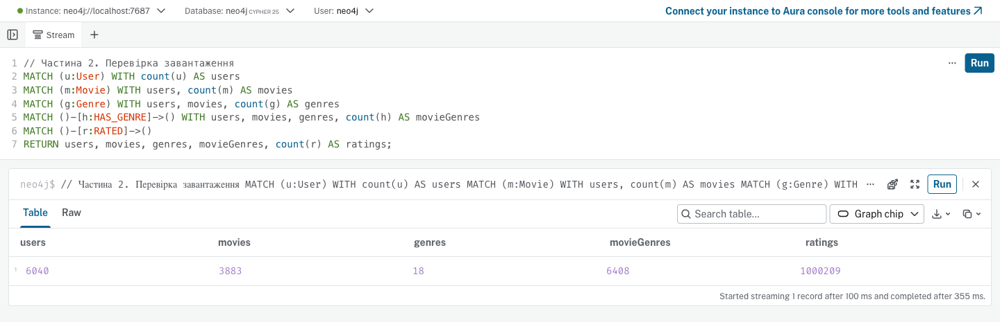

## Частина 3 — запити різної складності

Усі запити — у [`queries/part3.cypher`](queries/part3.cypher). Скриншоти зроблено
в Neo4j Browser; у таблиці видно перші 10–11 рядків результату.

### Запит 1. Фільми жанру «Thriller» із середнім рейтингом вище 4.0

```cypher
MATCH (:Genre {name: 'Thriller'})<-[:HAS_GENRE]-(m:Movie)<-[r:RATED]-(:User)
WITH m, avg(r.rating) AS avgRating, count(r) AS ratings
WHERE avgRating > 4.0
RETURN m.title AS title, m.year AS year, round(avgRating, 2) AS avgRating, ratings
ORDER BY avgRating DESC, ratings DESC;
```

- Обхід починається з єдиного вузла `Genre` (пошук за унікальним індексом), далі йде до 492
  трилерів і лише до їхніх оцінок — решта графа не читається.
- `WITH ... WHERE` після агрегації — це аналог `HAVING`: спершу рахуємо середнє для кожного
  фільму, потім відсікаємо за ним.
- `count(r)` виведено поруч із середнім, бо середнє без кількості оцінок мало що каже.
  Порога на мінімальну кількість оцінок у запиті немає (умова завдання — «всі фільми»);
  на цих даних він і не знадобився: найменш оцінюваний фільм у результаті має 43 оцінки.

Результат: 52 фільми, на чолі — The Usual Suspects (4.52, 1 783 оцінки), A Close Shave,
Rear Window, The Third Man, The Sixth Sense.

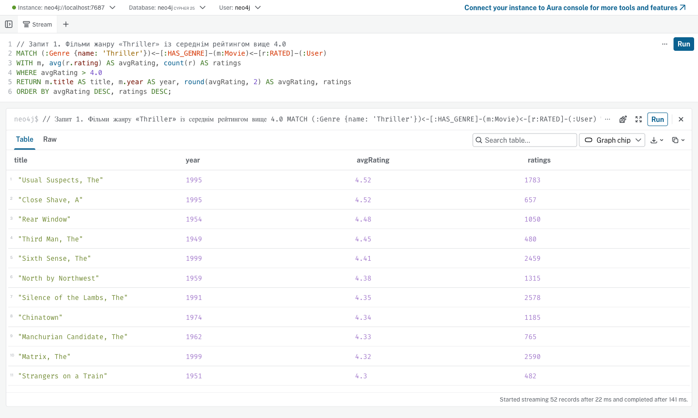

### Запит 2. Користувачі, які поставили оцінку 5 більш ніж 50 фільмам

```cypher
MATCH (u:User)-[r:RATED {rating: 5}]->(:Movie)
WITH u, count(r) AS fives
WHERE fives > 50
RETURN u.userId AS userId, u.gender AS gender, u.ageGroup AS ageGroup,
       u.occupation AS occupation, fives
ORDER BY fives DESC;
```

- Фільтр за властивістю ребра записано прямо в патерні: `{rating: 5}`.
- Групування за вузлом `u` (а не за `u.userId`) — агрегація йде за самим вузлом, властивості
  читаються лише для рядків, що пройшли фільтр `fives > 50`.
- Запит не має вибіркової точки входу, тому переглядає всі оцінки — це чесна ціна глобальної
  агрегації в графі (див. [частину 6](#2-де-граф-програє)).

Результат: 1 390 користувачів (23% усіх). Рекордсмен — користувач 4277 із 571 оцінкою «5».

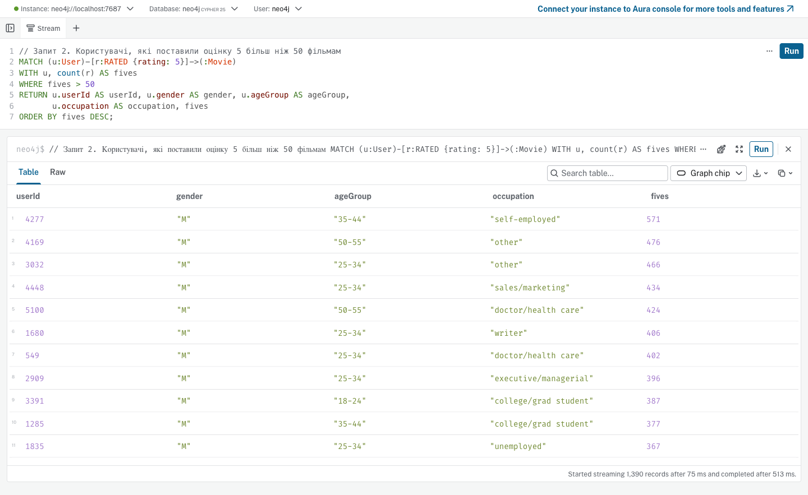

### Запит 3. Фільми, які обидва користувачі оцінили високо (рейтинг ≥ 4)

```cypher
MATCH (u1:User {userId: 1})-[r1:RATED]->(m:Movie)<-[r2:RATED]-(u2:User {userId: 2})
WHERE r1.rating >= 4 AND r2.rating >= 4
RETURN m.title AS title, m.year AS year, r1.rating AS user1, r2.rating AS user2
ORDER BY r1.rating + r2.rating DESC, title;
```

- Весь зв'язок «користувач → фільм ← користувач» — один патерн. Обидва кінці закріплені
  унікальним індексом, тож база розгортає оцінки лише цих двох користувачів (53 і 129 ребер).
- Умови на обидві оцінки стоять у `WHERE`, бо `>=` у фігурних дужках патерну записати не можна.
- Сортування за сумою оцінок піднімає нагору фільми, які сподобалися обом найбільше.

Результат: 6 фільмів, обидва поставили «5» лише One Flew Over the Cuckoo's Nest.

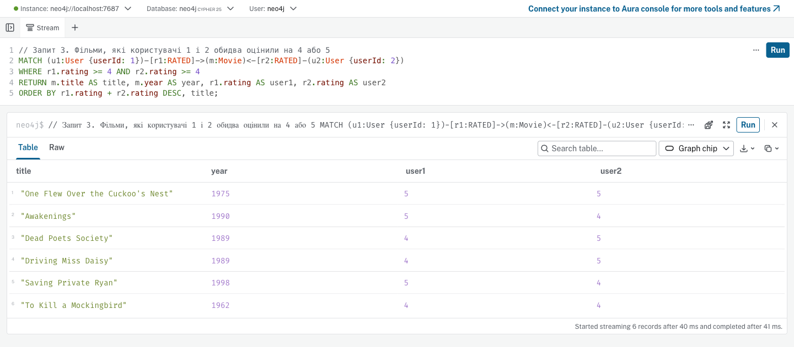

### Запит 4. Жанри, чиї фільми стабільно отримують високі оцінки

```cypher
MATCH (g:Genre)<-[:HAS_GENRE]-(m:Movie)<-[r:RATED]-(:User)
RETURN g.name AS genre,
       count(DISTINCT m) AS ratedMovies,
       count(r) AS ratings,
       round(avg(r.rating), 3) AS avgRating,
       round(stDev(r.rating), 3) AS stdDev,
       round(100.0 * sum(CASE WHEN r.rating >= 4 THEN 1 ELSE 0 END) / count(r), 1) AS pctHigh
ORDER BY avgRating DESC;
```

- Крім середнього рейтингу і кількості оцінок, яких вимагає завдання, є два показники
  «стабільності»: стандартне відхилення `stDev` (що менше, то одностайніші оцінки) і частка
  оцінок 4–5 `pctHigh`.
- `count(DISTINCT m)` — скільки фільмів жанру взагалі мають оцінки: без цього не видно,
  що високе середнє Film-Noir тримається на 44 фільмах.
- Фільм із кількома жанрами враховується в кожному з них — це очікувана поведінка для
  статистики «за жанрами».

```
genre          ratedMovies  ratings  avgRating  stdDev  pctHigh
Film-Noir               44    18261      4.075   0.933     76.3
Documentary            110     7910      3.933   1.033     72.3
War                    141    68527      3.893   1.065     69.4
Drama                 1493   354529      3.766   1.046     64.4
Crime                  201    79541      3.709   1.078     62.0
Animation              105    43293      3.685   1.082     61.5
Mystery                104    40178      3.668   1.087     60.5
Musical                113    41533      3.666   1.101     60.5
Western                 67    20683      3.638   1.100     59.5
Romance                459   147523      3.607   1.067     58.0
Thriller               485   189680      3.570   1.107     57.1
Comedy                1163   356580      3.522   1.121     55.2
Action                 495   257457      3.491   1.133     53.9
Adventure              281   133953      3.477   1.129     53.0
Sci-Fi                 274   157294      3.467   1.157     52.9
Fantasy                 68    36301      3.447   1.133     51.6
Children's             250    72186      3.422   1.161     51.6
Horror                 339    76386      3.215   1.226     44.6
```

Усі три показники впорядковують жанри майже однаково: у Film-Noir найвище середнє, найменший
розкид і найбільша частка високих оцінок, у Horror — навпаки. Тобто «високо» і «стабільно»
тут ідуть разом. Якщо враховувати ще й обсяг, то найнадійніший жанр — Drama: 3.77 на вибірці
з 354 тис. оцінок, тоді як лідерство Film-Noir і Documentary спирається на невелику кількість
фільмів, які дивиться зацікавлена аудиторія.

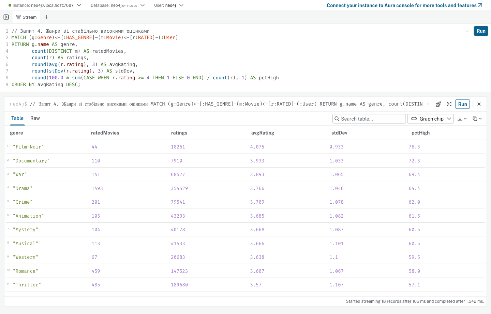

### Запит 5. Рекомендація «користувачі зі схожими смаками також дивилися»

```cypher
MATCH (me:User {userId: 1})-[r1:RATED]->(m:Movie)<-[r2:RATED]-(other:User)
WHERE r1.rating >= 4 AND r2.rating >= 4
WITH me, other, count(m) AS common
WHERE common >= 5
WITH me, other, common,
     COUNT { (me)-[x:RATED]->() WHERE x.rating >= 4 } AS myLiked,
     COUNT { (other)-[x:RATED]->() WHERE x.rating >= 4 } AS otherLiked
WITH me, other, toFloat(common) / (myLiked + otherLiked - common) AS similarity
ORDER BY similarity DESC
LIMIT 30
MATCH (other)-[r:RATED]->(rec:Movie)
WHERE r.rating >= 4
  AND NOT EXISTS { (me)-[:RATED]->(rec) }
WITH rec, count(other) AS neighbours, avg(r.rating) AS avgRating, sum(similarity) AS score
WHERE neighbours >= 3
RETURN rec.title AS title, rec.year AS year, neighbours,
       round(avgRating, 2) AS avgRating, round(score, 3) AS score
ORDER BY score DESC, avgRating DESC
LIMIT 10;
```

Це класична колаборативна фільтрація «користувач–користувач» у чотири кроки:

1. **Кандидати в сусіди** — користувачі, які високо (≥ 4) оцінили ті самі фільми, що й наш
   користувач; `common` — кількість таких збігів. `common >= 5` відсікає випадкові збіги
   на одному-двох блокбастерах.
2. **Схожість — коефіцієнт Жаккара**: спільні вподобані фільми, поділені на об'єднання
   вподобаних фільмів обох. Нормування тут принципове. Якщо ранжувати сусідів просто за
   кількістю спільних фільмів, «найсхожішими» виявляються найактивніші користувачі (у кого
   тисячі оцінок, той збігається з усіма), і запит радить те, що популярне загалом: для цього ж
   користувача такий варіант повертав It's a Wonderful Life, The Silence of the Lambs, Psycho.
3. **30 найближчих сусідів** (`ORDER BY similarity DESC LIMIT 30`).
4. **Рекомендації** — фільми, які сусіди оцінили на 4–5, а користувач не оцінював узагалі
   (`NOT EXISTS { (me)-[:RATED]->(rec) }` виключає і ті, що він бачив, але оцінив низько).
   `score` — сума схожостей сусідів, які радять фільм; `neighbours >= 3` вимагає, щоб фільм
   радили принаймні троє.

Користувач 1 — школярка (вікова група «Under 18»), серед 45 вподобаних фільмів якої переважають
мультфільми Disney і сімейне кіно (Cinderella, Bambi, Aladdin, Mulan, Toy Story, Mary Poppins).
Рекомендації цьому відповідають: The Little Mermaid, The Lion King, Babe, The Jungle Book,
Lady and the Tramp, Peter Pan — і кілька загальних улюбленців на кшталт The Shawshank Redemption.

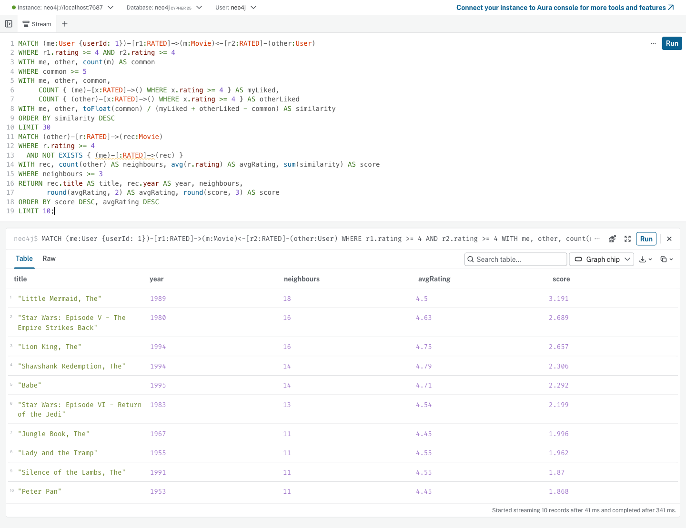

### Запит 6. Найкоротший ланцюжок між двома користувачами через спільні фільми

```cypher
// 6a. Користувачі 1 і 2 мають спільні фільми -> шлях довжини 2.
MATCH p = shortestPath((u1:User {userId: 1})-[:RATED*..10]-(u2:User {userId: 2}))
RETURN [n IN nodes(p) | coalesce(n.title, 'User ' + toString(n.userId))] AS chain,
       length(p) AS hops;

// 6b. Користувачі 1 і 46 не мають жодного спільного фільму -> шлях довжини 4.
MATCH p = shortestPath((u1:User {userId: 1})-[:RATED*..10]-(u2:User {userId: 46}))
RETURN [n IN nodes(p) | coalesce(n.title, 'User ' + toString(n.userId))] AS chain,
       length(p) AS hops;

// 6c. Розподіл довжин найкоротших шляхів від користувача 1 до всіх інших.
MATCH (u1:User {userId: 1})
MATCH (u2:User)
WHERE u2 <> u1
MATCH p = shortestPath((u1)-[:RATED*..10]-(u2))
RETURN length(p) AS hops, count(*) AS users
ORDER BY hops;
```

- `shortestPath` виконує двонапрямний пошук у ширину від обох кінців і зупиняється на першому
  знайденому шляху, не перебираючи всі можливі.
- Ребро в патерні **без напрямку** (`-[:RATED*..10]-`): усі ребра `RATED` ведуть від користувача
  до фільму, тож шлях між двома користувачами неминуче проходить кожне друге ребро «проти стрілки».
- Тип ребра обмежено до `RATED`, щоб шлях не зрізав дорогу через вузли жанрів, а `*..10` —
  запобіжник від надто довгих пошуків.
- `coalesce(n.title, 'User ' + ...)` перетворює шлях на зрозумілий ланцюжок: у фільмів є `title`,
  у користувачів — ні.

Результати:

```
6a: ["User 1", "Awakenings", "User 2"]                                                 hops = 2
6b: ["User 1", "Cinderella", "User 536", "Wes Craven's New Nightmare", "User 46"]      hops = 4
6c: hops = 2 → 5899 користувачів;  hops = 4 → 140 користувачів
```

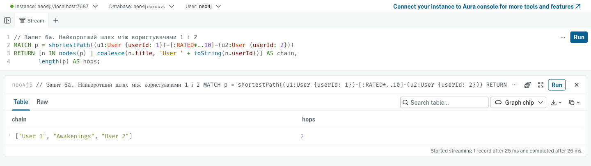
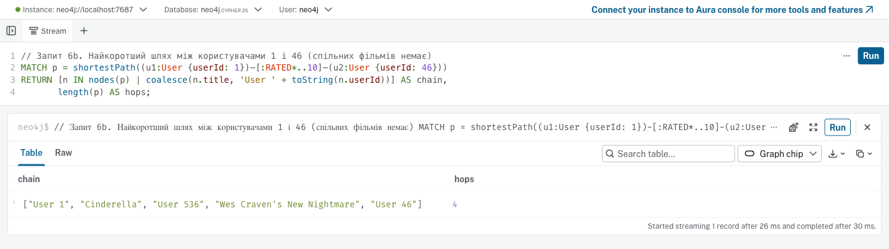

Той самий шлях 6b у вигляді графа (`RETURN p`):

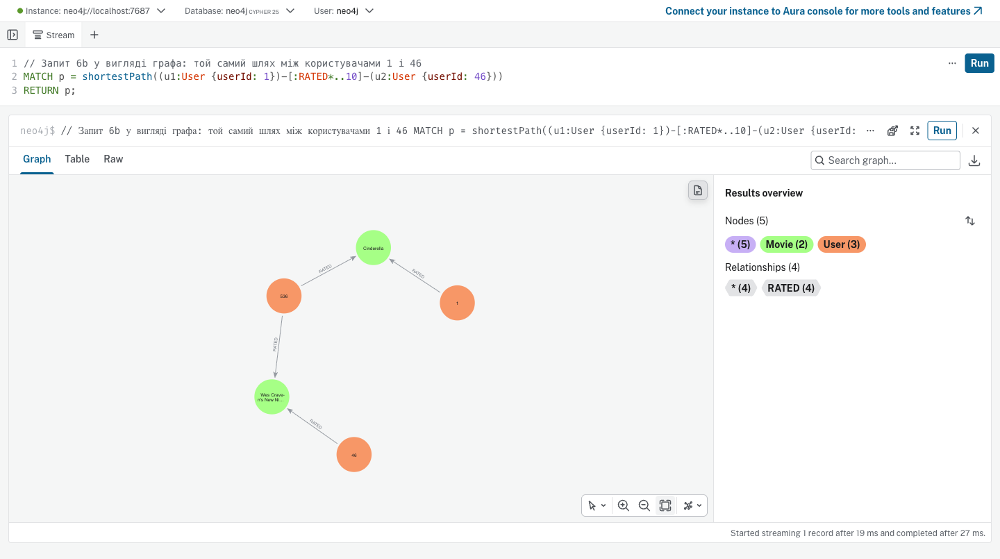
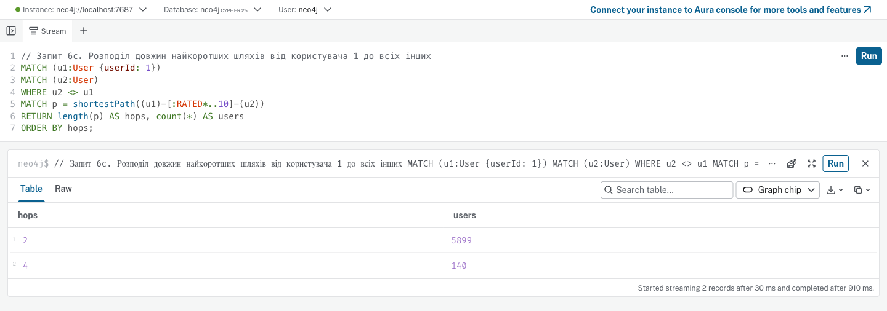

### Відповіді на запитання

**Що означає довжина шляху в цьому контексті?** Довжина — це кількість ребер `RATED` у ланцюжку.
Граф користувачів і фільмів двочастковий (ребра є лише між користувачем і фільмом), тому шлях
між двома користувачами завжди має парну довжину: кожен «перехід» від людини до людини — це два
ребра через фільм, який оцінили обидва. Довжина / 2 — кількість фільмів-посередників («рукостискань»),
довжина / 2 − 1 — кількість проміжних користувачів.

**Шлях довжини 2** — користувачі оцінили той самий фільм (1 і 2 обидва оцінили Awakenings).

**Шлях довжини 4** — спільних фільмів у користувачів немає, але є спільний «знайомий»: третій
користувач, який має спільний фільм із кожним із них. У прикладі 6b любителька Disney
(користувач 1) і користувач 46 пов'язані через користувача 536, який оцінив і Cinderella,
і Wes Craven's New Nightmare. Це відстань «друг мого друга», і саме на ній працює
колаборативна фільтрація: рекомендації із запиту 5 — це фільми на відстані 3 від користувача
(його фільм → сусід → фільм сусіда).

**Шлях довжини 6** — немає ні спільних фільмів, ні спільних «знайомих»: ланцюжок іде через двох
проміжних користувачів і три фільми. Це вже дуже слабкий зв'язок, який про схожість смаків
практично нічого не каже. У цьому датасеті для користувача 1 таких шляхів немає взагалі:
5 899 з 6 039 інших користувачів (97,7%) мають із ним спільний фільм, решта 140 — на відстані 4.
Причина — популярні фільми, які оцінила більшість (див. супервузли в частині 4).

Два застереження до інтерпретації. По-перше, `shortestPath` не дивиться на значення оцінки:
ланцюжок може йти через фільм, який один користувач обожнює, а інший оцінив на «1». По-друге,
більшість коротких шляхів проходить через блокбастери і означає лише «обидва бачили дуже
популярний фільм». Щоб шлях відображав саме спільний смак, треба ходити лише ребрами з оцінкою
≥ 4 і зважати зв'язки — це зроблено в [частині 5.3](#53-найкоротший-шлях-між-користувачами-dijkstra).

## Частина 4 — виявлення супервузлів

Усі запити — у [`queries/part4_supernodes.cypher`](queries/part4_supernodes.cypher).

### Запити

**4.1. Розподіл ступенів за мітками** — що вважати «звичайним» вузлом.

```cypher
MATCH (n)
WITH labels(n)[0] AS label, COUNT { (n)--() } AS degree
RETURN label,
       count(*) AS nodes,
       min(degree) AS minDegree,
       round(avg(degree), 1) AS avgDegree,
       toInteger(percentileCont(degree, 0.5)) AS median,
       toInteger(percentileCont(degree, 0.99)) AS p99,
       max(degree) AS maxDegree
ORDER BY label;
```

«Аномально великий» має сенс лише відносно типового значення, тому спершу рахуємо медіану,
середнє і 99-й перцентиль для кожної мітки. `COUNT { (n)--() }` без фільтрів не перебирає ребра:
ступінь береться з лічильників самого вузла, тож запит дешевий навіть для найбільших вузлів.

```
label    nodes  minDegree  avgDegree  median   p99  maxDegree
Genre       18         44      356.0     231  1534       1603
Movie     3883          1      259.2     111  1759       3430
User      6040         20      165.6      96   906       2314
```

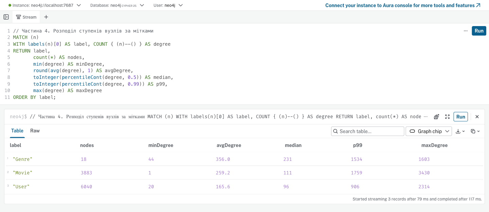

**4.2. Вузли з найбільшою кількістю ребер** (крок 1 із завдання).

```cypher
MATCH (n)
WITH n, labels(n)[0] AS label, COUNT { (n)--() } AS degree
RETURN label,
       coalesce(n.title, n.name, 'User ' + toString(n.userId)) AS node,
       degree
ORDER BY degree DESC
LIMIT 15;
```

Запит іде по всіх вузлах без огляду на мітку, щоб супервузли різних типів потрапили в один
рейтинг; `coalesce` підбирає зрозумілу назву для фільму, жанру чи користувача.

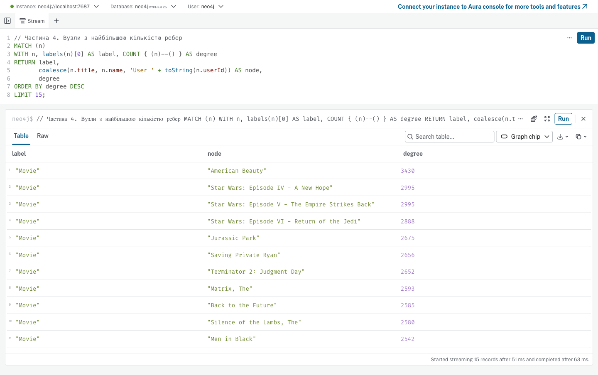

**4.3. Найактивніші користувачі** — супервузли з боку `User`.

```cypher
MATCH (u:User)
WITH u, COUNT { (u)-[:RATED]->() } AS ratings
RETURN u.userId AS userId, u.gender AS gender, u.ageGroup AS ageGroup,
       u.occupation AS occupation, ratings
ORDER BY ratings DESC
LIMIT 10;
```

У загальному рейтингу 4.2 всі 15 місць займають фільми, тому користувачів шукаємо окремим
запитом. Ступінь рахується за типом і напрямком ребра (`-[:RATED]->`): такий патерн без
фільтрів за властивостями планувальник теж зводить до читання ступеня вузла, а не до перебору
ребер. Стать, вік і професію виведено, щоб було видно, хто ці користувачі.

```
userId  gender  ageGroup  occupation              ratings
4169    M       50-55     other                   2314
1680    M       25-34     writer                  1850
4277    M       35-44     self-employed           1743
1941    M       35-44     technician/engineer     1595
1181    M       35-44     executive/managerial    1521
```

**4.4. Ступені жанрових вузлів** — перевірка підказки із завдання про жанри.

```cypher
MATCH (m:Movie)
WITH count(m) AS totalMovies
MATCH (g:Genre)
WITH g, totalMovies, COUNT { (g)<-[:HAS_GENRE]-() } AS movies
RETURN g.name AS genre, movies, round(100.0 * movies / totalMovies, 1) AS pctOfMovies
ORDER BY movies DESC;
```

Абсолютний ступінь жанру (сотні ребер) поруч із фільмами виглядає скромно, тому запит виводить
ще й частку від усіх фільмів: саме вона показує, яку частину графа «чіпляє» один вузол.
Загальна кількість фільмів рахується один раз у першому `WITH` і переноситься далі, а не
обчислюється для кожного жанру.

```
genre       movies  pctOfMovies
Drama         1603         41.3
Comedy        1200         30.9
Action         503         13.0
Thriller       492         12.7
Romance        471         12.1
...
Film-Noir       44          1.1
```

**4.5. Концентрація оцінок** — яка частка всіх ребер `RATED` припадає на 1% і 10%
найпопулярніших фільмів.

```cypher
MATCH (m:Movie)
WITH m, COUNT { (m)<-[:RATED]-() } AS degree
ORDER BY degree DESC
WITH collect(degree) AS degrees, sum(degree) AS total
WITH degrees, total,
     toInteger(ceil(size(degrees) * 0.01)) AS top1,
     toInteger(ceil(size(degrees) * 0.10)) AS top10
RETURN total AS ratings,
       top1 AS moviesInTop1pct,
       round(100.0 * reduce(s = 0, d IN degrees[..top1] | s + d) / total, 1) AS pctRatingsTop1pct,
       top10 AS moviesInTop10pct,
       round(100.0 * reduce(s = 0, d IN degrees[..top10] | s + d) / total, 1) AS pctRatingsTop10pct;
```

Топ-список показує окремі вузли, а цей запит — форму всього розподілу: це кілька винятків чи
системна нерівномірність. Ступені сортуються за спаданням і збираються в один список;
`degrees[..top1]` — зріз перших N елементів, `reduce` його підсумовує. Межі зрізу рахуються
через `ceil`, щоб 1% від 3 883 фільмів дав 39, а не 38.

```
ratings  moviesInTop1pct  pctRatingsTop1pct  moviesInTop10pct  pctRatingsTop10pct
1000209               39                9.1               389                45.7
```

**4.6. Той самий обхід для супервузла і для звичайного вузла.**

```cypher
// Супервузол: American Beauty (movieId = 2858), 3 428 оцінок.
PROFILE
MATCH (m:Movie {movieId: 2858})<-[:RATED]-(u:User)-[:RATED]->(other:Movie)
RETURN m.title AS movie, count(*) AS paths, count(DISTINCT other) AS otherMovies;

// Звичайний вузол: All the King's Men (movieId = 1942), 119 оцінок (близько до медіани).
PROFILE
MATCH (m:Movie {movieId: 1942})<-[:RATED]-(u:User)-[:RATED]->(other:Movie)
RETURN m.title AS movie, count(*) AS paths, count(DISTINCT other) AS otherMovies;
```

Це типовий крок рекомендацій — «що ще оцінювали глядачі цього фільму». Два запити відрізняються
лише значенням `movieId`, і обидва стартують з унікального індексу, тому різницю у вартості
можна пояснити тільки ступенем стартового вузла. `PROFILE` виконує запит і показує фактичну
кількість звернень до сховища (DbHits) для кожного оператора плану; `count(*)` рахує пройдені
шляхи, `count(DISTINCT other)` — скільки різних фільмів досягнуто.

```
movie               paths   otherMovies  DbHits   Time
American Beauty     714252         3659  1444953  228 ms
All the King's Men   49927         3314   100449   24 ms
```

**4.7. Фільтр за властивістю ребра на супервузлі.**

```cypher
PROFILE
MATCH (m:Movie {movieId: 2858})<-[r:RATED]-(u:User)
WHERE r.rating = 1
RETURN m.title AS movie, count(u) AS usersRatedOne;
```

Перевіряє, чи рятує супервузол вибірковий фільтр. Умова стоїть на властивості ребра, індексу
на ній немає, тож базі доводиться розгорнути всі ребра вузла і прочитати `rating` у кожного.
Результат: 83 користувачі і 6 945 DbHits. Вимірювання 4.6 і 4.7 розібрано у відповіді
на питання 2.

### 1. Які вузли виявилися супервузлами? Скільки в них зв'язків?

**Фільми-блокбастери.** При медіані 111 ребер на фільм:

| Фільм | Ребер | Разів від медіани |
|---|---:|---:|
| American Beauty | 3 430 | 31× |
| Star Wars: Episode IV — A New Hope | 2 995 | 27× |
| Star Wars: Episode V — The Empire Strikes Back | 2 995 | 27× |
| Star Wars: Episode VI — Return of the Jedi | 2 888 | 26× |
| Jurassic Park | 2 675 | 24× |
| Saving Private Ryan | 2 656 | 24× |
| Terminator 2: Judgment Day | 2 652 | 24× |
| The Matrix | 2 593 | 23× |

(ступінь = оцінки + 1–6 ребер `HAS_GENRE`; у American Beauty 3 428 оцінок і 2 жанри).
American Beauty оцінили 57% усіх користувачів. Розподіл дуже нерівномірний: 1% найпопулярніших
фільмів (39 штук) збирає 9,1% усіх оцінок, 10% фільмів (389) — 45,7%.

**Найактивніші користувачі.** При медіані 96 оцінок: користувач 4169 — 2 314 оцінок (24× від
медіани, 60% усіх фільмів), 1680 — 1 850, 4277 — 1 743, 1941 — 1 595, 1181 — 1 521.

**Жанрові вузли.** Drama — 1 603 фільми (41,3% усіх фільмів), Comedy — 1 200 (30,9%), далі
Action — 503, Thriller — 492, Romance — 471. Мінімум — Film-Noir із 44 фільмами.

За абсолютними числами це невеликі вузли (справжні супервузли мають сотні тисяч і мільйони
ребер), але відносно розміру графа вони саме такі: один вузол пов'язаний з половиною всіх
вузлів іншого типу, і всі наслідки вже видно на вимірюваннях.

### 2. Чому запит через супервузол повільніший

Індекс відповідає лише за те, щоб **знайти стартовий вузол**, і тут супервузол нічим не
відрізняється від звичайного — в обох випадках це 2 звернення до сховища. Далі починається
обхід, а його вартість пропорційна кількості ребер, які треба пройти: Neo4j переходить від вузла
до сусідів за вказівниками (index-free adjacency), тобто читає кожне ребро вузла. Індекс вузлів
у цьому не допомагає ніяк.

Той самий запит «що ще оцінювали глядачі цього фільму» для двох фільмів (запити 4.6):

```cypher
PROFILE
MATCH (m:Movie {movieId: 2858})<-[:RATED]-(u:User)-[:RATED]->(other:Movie)
RETURN m.title AS movie, count(*) AS paths, count(DISTINCT other) AS otherMovies;
```

| | American Beauty (супервузол) | All the King's Men (звичайний) |
|---|---:|---:|
| Оцінок у фільму | 3 428 | 119 |
| Пошук фільму за індексом, DbHits | 2 | 2 |
| Шляхів на другому кроці | 714 252 | 49 927 |
| Усього DbHits | 1 444 953 | 100 449 |
| Час | 228 мс | 24 мс |

Чому різниця така велика:

- **Обхід лінійний за ступенем, а на наступному кроці множиться.** 3 428 глядачів American
  Beauty мають у середньому по 208 інших оцінок, тому другий крок — це вже 714 тисяч шляхів.
  Супервузол збільшує не один крок, а все, що йде після нього. (Різниця між двома фільмами
  у 14 разів, а не в 29, бо стару класику оцінюють переважно дуже активні користувачі:
  у глядачів All the King's Men у середньому по 420 інших оцінок.)
- **Фільтр за властивістю ребра не скорочує роботу** (запит 4.7). Щоб знайти 83 користувачів,
  які поставили American Beauty оцінку «1», база розгортає всі 3 428 ребер і в кожного читає
  `rating`: 6 945 звернень заради 83 рядків.
- **Планувальник помиляється в оцінках.** Він оцінює розгортання за середнім ступенем: у плані
  для обох фільмів очікувалося 258 рядків після першого кроку (це середня кількість оцінок
  на фільм), а фактично в American Beauty їх 3 428 — помилка в 13 разів. На складніших
  запитах така недооцінка веде до невдалого порядку з'єднань.
- **Проміжні результати займають пам'ять.** У частині 5 побудова пар «користувач–користувач»
  через спільні фільми в лоб вичерпала пам'ять транзакції саме через блокбастери: один фільм
  із 2 853 високими оцінками породжує 4 млн пар.
- **Записи конкурують за один вузол.** Кожна нова оцінка популярного фільму блокує той самий
  вузол — це причина `parallel: false` при завантаженні.

### 3. Стратегія для цього датасету

Для фільмів і користувачів я застосував би три стратегії; перші дві виміряно в
[`queries/part6_improvements.cypher`](queries/part6_improvements.cypher) (цифри — в
[частині 6](#3-покращення-схеми)).

1. **Розбиття ребер супервузла за типом.** Майже всі запити рекомендацій цікавляться лише
   високими оцінками, але змушені читати всі ребра `RATED` і перевіряти властивість кожного.
   Якщо оцінки ≥ 4 продублювати окремим типом ребра `LIKED`, обхід `-[:LIKED]->` читає лише
   потрібну частину ребер без перевірки властивостей: у щільних вузлів Neo4j зберігає ребра
   групами за типом і напрямком. На запиті 5 це зменшило кількість звернень у 12 разів.
2. **Денормалізовані агрегати на вузлі.** Питання «скільки оцінок і який середній рейтинг
   у фільму» не мусить щоразу проходити тисячі ребер: `ratingCount`, `ratingSum`, `avgRating`
   зберігаються на вузлі `Movie` і оновлюються при записі. Запит 1 після цього взагалі не
   торкається ребер `RATED` (у 475 разів менше звернень).
3. **Не ходити крізь супервузол, якщо він не несе сигналу.** Те, що двоє людей бачили American
   Beauty, майже нічого не каже про схожість їхніх смаків. У запитах схожості такі вузли варто
   або відсікати за ступенем (`WHERE COUNT { (m)<-[:RATED]-() } < 2000` — перевірка ступеня
   миттєва), або зменшувати їхню вагу. У запиті 5 цю роль з боку користувачів виконує
   нормування Жаккара: воно не дає «всеїдним» користувачам із тисячами оцінок стати сусідами
   для всіх.

**Жанрові вузли — теж супервузли, і з ними треба поводитися інакше.** Вони щільні не випадково,
а за побудовою: 18 категорій на 3 883 фільми, Drama покриває 41%. Їх не треба ні розбивати,
ні прибирати — треба розрізняти два способи використання:

- **Як точка входу — добре.** Запити 1 і 4 починають із жанру і читають його фільми; тут
  читається рівно те, що потрібно для відповіді.
- **Як проміжна ланка — погано.** Патерн `(m1)-[:HAS_GENRE]->(g)<-[:HAS_GENRE]-(m2)` для
  драми дає 1 602 «схожі» фільми без жодної корисної інформації, а якби дозволити ребра
  `HAS_GENRE` у пошуку шляхів, будь-які два фільми виявилися б на відстані 2 і поняття
  «близькості» в графі зникло б. Тому в запиті 6 тип ребра явно обмежено до `RATED`.

Що з ними робити на практиці:

1. обмежувати типи ребер у запитах на шляхи і схожість, щоб обхід не проходив крізь `Genre`;
2. для фільтрації вже знайдених фільмів за жанром продублювати жанр на самому фільмі — міткою
   (`:Movie:Drama`) або списком у властивості; тоді перевірка не потребує переходу;
3. якщо потрібна схожість «за змістом» — порівнювати набори жанрів двох конкретних фільмів
   (їх від 1 до 6) або додати дрібніші, вибірковіші вузли (піджанри, теги, ключові слова),
   а рідкісним жанрам давати більшу вагу: збіг за Film-Noir (44 фільми) каже значно більше,
   ніж збіг за Drama (1 603).

## Частина 5 — графові алгоритми через GDS (додаткова)

Усі запити — у [`queries/part5_gds.cypher`](queries/part5_gds.cypher); файл цілком виконується
близько 6,5 хвилини і наприкінці повертає граф до базової схеми.

Відмінності від шаблонів завдання:

- `id(a) < id(b)` замінено на `elementId(a) < elementId(b)` для фільмів і на
  `u1.userId < u2.userId` для користувачів — `id()` у Neo4j 2026 застаріла. Будь-яке строге
  впорядкування годиться: воно лише гарантує, що кожна невпорядкована пара рахується один раз.
- Крок 1 для користувачів переписано з підзапитом `CALL (u1) { ... }` — інакше він не вміщається
  в пам'ять (пояснення в 5.2).
- Ребра `SIMILAR` отримали другу властивість `cost = 1 / weight` для Дейкстри, тому одна
  проєкція `userSimilarity` обслуговує і 5.2, і 5.3 (перестворювати її 5 хвилин немає сенсу).
- У Louvain задано `concurrency: 1` заради відтворюваності.

### 5.1. PageRank на графі фільмів

**Крок 1 — ребра «фільм–фільм».** Вага `CO_RATED` — кількість користувачів, які оцінили обидва
фільми на 4–5; беруться 50 000 найсильніших пар серед фільмів із понад 20 оцінками.

```cypher
MATCH (m1:Movie)<-[r1:RATED]-(u:User)-[r2:RATED]->(m2:Movie)
WHERE r1.rating >= 4 AND r2.rating >= 4 AND elementId(m1) < elementId(m2)
WITH m1, m2, count(u) AS weight
WHERE COUNT { (m1)<-[:RATED]-() } > 20
  AND COUNT { (m2)<-[:RATED]-() } > 20
WITH m1, m2, weight
ORDER BY weight DESC
LIMIT 50000
MERGE (m1)-[co:CO_RATED]-(m2)
SET co.weight = weight;
```

У граф потрапило 794 фільми з 3 883 (ваги ребер від 157 до 1 960); решта лишилися без ребер.

**Крок 2 — проєкція** (`gds.graph.project`, як у завданні): 3 883 вузли, 100 000 орієнтованих
ребер (кожне неорієнтоване зберігається у двох напрямках).

**Крок 3 — PageRank.**

```cypher
CALL gds.pageRank.stream('movieGraph', {
  relationshipWeightProperty: 'weight',
  dampingFactor: 0.85,
  maxIterations: 100
})
YIELD nodeId, score
WITH gds.util.asNode(nodeId) AS m, score
ORDER BY score DESC
LIMIT 20
MATCH (m)<-[r:RATED]-(:User)
RETURN m.title AS title, m.year AS year, round(score, 2) AS pageRank,
       count(r) AS ratings,
       sum(CASE WHEN r.rating >= 4 THEN 1 ELSE 0 END) AS likes,
       round(avg(r.rating), 2) AS avgRating
ORDER BY pageRank DESC;
```

- `relationshipWeightProperty: 'weight'` — перехід до сусіда тим імовірніший, чим більше
  в фільмів спільних шанувальників; без ваги всі 50 000 ребер були б рівноцінними.
- `maxIterations: 100` замість типових 20: за 20 ітерацій алгоритм на цьому графі не збігався
  (`didConverge: false`), а зі 100 збігається на 88-й.
- Одразу поруч виводяться кількість оцінок, кількість оцінок 4–5 і середній рейтинг, щоб
  порівняти PageRank зі звичайною популярністю.

```
title                                           year  pageRank  ratings  likes  avgRating
American Beauty                                 1999      9.95     3428   2853       4.32
Star Wars: Episode IV - A New Hope              1977      9.45     2991   2622       4.45
Star Wars: Episode V - The Empire Strikes Back  1980      9.41     2990   2510       4.29
Raiders of the Lost Ark                         1981      8.23     2514   2260       4.48
Fargo                                           1996      7.29     2513   2074       4.25
Silence of the Lambs, The                       1991      6.98     2578   2252       4.35
Godfather, The                                  1972      6.55     2223   1989       4.52
Matrix, The                                     1999      6.54     2590   2171       4.32
Shawshank Redemption, The                       1994      6.54     2227   2046       4.55
Sixth Sense, The                                1999      6.48     2459   2163       4.41
```

Далі `gds.pageRank.write` записує оцінку у властивість `pagerank`, і два запити ставлять кожному
фільму тимчасові ранги — за кількістю оцінок (`popularityRank`) і за PageRank (`pagerankRank`).
На них побудовано три перевірки.

Кореляція PageRank з іншими показниками (794 фільми з ребрами, `gds.similarity.pearson`):

| Показник | Кореляція з PageRank |
|---|---:|
| зважений ступінь вузла (сума ваг `CO_RATED`) | 0.989 |
| кількість оцінок 4–5 | 0.982 |
| кількість усіх оцінок | 0.918 |
| середній рейтинг | 0.429 |

Популярні фільми, які PageRank опускає (серед топ-100 за кількістю оцінок):

```
title                                      popularityRank  pagerankRank  shift  ratings  avgRating
Arachnophobia                                          92           449   -357     1367       3.00
Austin Powers: The Spy Who Shagged Me                  77           276   -199     1434       3.39
Mission: Impossible                                    64           165   -101     1527       3.43
Face/Off                                               80           179    -99     1421       3.40
Titanic                                                62           156    -94     1546       3.58
American Pie                                           85           174    -89     1389       3.71
Star Wars: Episode I - The Phantom Menace              22           102    -80     2250       3.41
Independence Day (ID4)                                 42           113    -71     1730       3.51
```

Фільми, які PageRank піднімає (серед топ-100 за PageRank):

```
title                popularityRank  pagerankRank  shift  ratings  avgRating
Sting, The                      188            84    104     1049       4.32
Rear Window                     187            86    101     1050       4.48
Citizen Kane                    161            77     84     1116       4.39
M*A*S*H                         166            93     73     1099       4.12
Young Frankenstein              133            66     67     1193       4.25
Apocalypse Now                  137            71     66     1176       4.24
Chinatown                       134            72     62     1185       4.34
```

**Крок 4 — прибирання**: видаляються проєкція, ребра `CO_RATED` і тимчасові властивості.

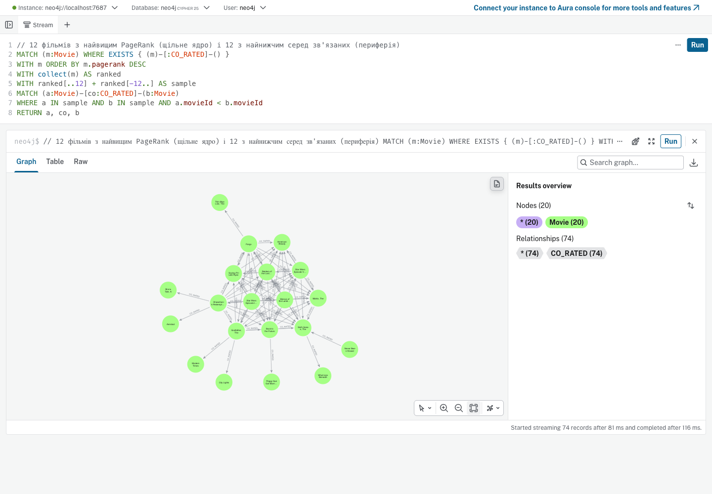

На скриншоті — 12 фільмів із найвищим PageRank і 12 з найнижчим серед тих, що мають ребра.
Лідери утворюють щільне ядро, де кожен пов'язаний з кожним; фільми з низьким PageRank тримаються
за ядро одним ребром.

#### Що означає високий PageRank для фільму в цьому графі?

Ребро `CO_RATED` означає «ці два фільми подобаються тим самим людям», тож високий PageRank має
фільм, який **подобається разом із багатьма іншими фільмами, що теж подобаються багатьом**.
Це центр спільних уподобань — «канон», довкола якого сходяться смаки більшості.

Це не просто «популярний фільм», і різницю видно на даних:

- граф будується лише з оцінок 4–5, тому фільми, які багато хто *бачив*, але мало хто *вподобав*,
  падають: Arachnophobia — 92-га за кількістю оцінок і 449-та за PageRank (середній рейтинг 3.0),
  The Phantom Menace — з 22-го місця на 102-ге, Titanic — з 62-го на 156-те;
- класика, яку оцінювало менше людей, але високо і ті самі глядачі, що цінують інші сильні
  фільми, піднімається: The Sting — зі 188-го місця на 84-те, Rear Window — зі 187-го на 86-те.

Але й «якістю» PageRank назвати не можна. У неорієнтованому графі він майже повторює зважений
ступінь вузла (кореляція 0.989), тобто по суті рахує, скільки разів фільм уподобали в парі
з іншими фільмами ядра. З кількістю високих оцінок кореляція 0.982, а із середнім рейтингом —
лише 0.429. Отже, це «популярність серед тих, кому сподобалося»: фільм із рейтингом 4.5, який
бачили 300 людей, у лідери не потрапить. Крім того, обмеження в 50 000 ребер залишає в графі
лише 794 фільми — решта отримує базові 0.15 і між собою не розрізняється.

### 5.2. Виявлення спільнот (Louvain)

**Крок 1 — ребра «користувач–користувач».**

```cypher
MATCH (u1:User)
CALL (u1) {
  MATCH (u1)-[r1:RATED]->(m:Movie)<-[r2:RATED]-(u2:User)
  WHERE r1.rating >= 4 AND r2.rating >= 4 AND u1.userId < u2.userId
  RETURN u2, count(m) AS weight
}
WITH u1, u2, weight
ORDER BY weight DESC
LIMIT 50000
MERGE (u1)-[sim:SIMILAR]-(u2)
SET sim.weight = weight,
    sim.cost   = 1.0 / weight;
```

Запит із шаблону (одна агрегація `WITH u1, u2, count(m)` на весь граф) при heap 2 ГБ завершився
помилкою `memory pool out of memory`: проміжна таблиця мала б містити до 18 млн пар користувачів
одночасно. У переписаному варіанті агрегація йде в підзапиті окремо для кожного `u1`, тож у пам'яті
одночасно лежать сусіди лише одного користувача (не більше 6 039 рядків), а `ORDER BY ... LIMIT`
тримає тільки поточні 50 000 найкращих. Результат той самий, пам'ять обмежена, збільшувати heap
не довелося. Крок триває 5–6 хвилин.

У граф схожості потрапив 1 221 користувач із 6 040 (ваги від 117 до 734 спільних фільмів).
Це найактивніші користувачі: щоб мати з кимось 117 спільних уподобаних фільмів, треба самому
вподобати щонайменше стільки ж.

**Крок 2 — проєкція** `userSimilarity` з властивостями `weight` і `cost`.

**Крок 3 — Louvain.**

```cypher
CALL gds.louvain.write('userSimilarity', {
  relationshipWeightProperty: 'weight',
  writeProperty: 'community',
  concurrency: 1
})
YIELD communityCount, modularity, ranLevels
RETURN communityCount, round(modularity, 4) AS modularity, ranLevels;
```

- Режим `write` зберігає номер спільноти у властивість `User.community`, щоб далі аналізувати
  спільноти звичайними Cypher-запитами.
- `concurrency: 1` — заради відтворюваності. У паралельному режимі Louvain недетермінований:
  п'ять запусків підряд дали то 3 спільноти (≈790 / 240 / 190), то 4 (≈750 / 220 / 170 / 75).
  В один потік результат щоразу однаковий.

Результат: `communityCount = 4822`, `modularity = 0.1586`.

```
community  users          clusterSize             clusters  users
4276         792          1 (ізольований вузол)       4819   4819
1736         239          10+                            3   1221
1273         190
(далі — спільноти з одного користувача)
```

Розподіл дуже нерівний, і це наслідок побудови графа, а не властивість аудиторії: 4 819
користувачів не мають жодного ребра `SIMILAR` (не потрапили в 50 000 найсильніших пар), і Louvain
лишає кожного окремою «спільнотою». Справжніх спільнот три — 792, 239 і 190 користувачів.
Номери спільнот (4276, 1736, 1273) — це просто ідентифікатори, вони можуть відрізнятися від
запуску до запуску.

**Крок 4 — жанри спільнот.** Три найпопулярніші жанри за кількістю оцінок 4–5 (запит 4а):

```
community  users  top3Genres
4276         792  Drama 68381, Comedy 55504, Action 37491
1736         239  Comedy 29292, Drama 27123, Action 23247
1273         190  Drama 31320, Comedy 22630, Thriller 10813
```

За абсолютними числами спільноти майже не відрізняються: Drama і Comedy лідирують усюди просто
тому, що це найбільші жанри датасету. Тому запит 4б рахує `lift` — у скільки разів частка жанру
серед уподобань спільноти більша або менша, ніж серед уподобань усіх користувачів:

```
community  users  overRepresented                                           underRepresented
4276         792  Documentary x1.14, Western x1.1, Drama x1.06, Crime x1.06   Animation x0.93, Children's x0.94, Adventure x0.94
1736         239  Children's x1.26, Action x1.17, Fantasy x1.16, Adventure x1.15   Documentary x0.47, Film-Noir x0.49, Mystery x0.82
1273         190  Documentary x1.82, Film-Noir x1.38, Drama x1.26, Mystery x1.25   Action x0.7, Sci-Fi x0.75, Adventure x0.76
```

Найхарактерніші фільми (запит 4в — ті, що спільнота вподобала значно частіше за решту графа):

```
4276  American Beauty x0.97, Dr. Strangelove x0.95, The Empire Strikes Back x0.95, The Godfather x0.95, Fargo x0.95
1736  The Saint (1997) x2.94, Lethal Weapon 4 (1998) x2.85, Tommy Boy (1995) x2.85, Far and Away (1992) x2.84, Hook (1991) x2.79
1273  The Best Years of Our Lives (1946) x3.21, Badlands (1973) x3.16, Take the Money and Run (1969) x2.86, Klute (1971) x2.85, The 39 Steps (1935) x2.8
```

Демографія й активність (запит 4г) та будова спільнот у графі (запит 4ґ):

```
community  users  pctMale  avgAgeGroupStart  avgRated  avgLiked  avgMovieYear  avgDegree  avgInsideShare  leaves
4276         792     77.0              30.6       376       209        1985.9       34.4            0.80     161
1736         239     82.0              26.1       577       341        1988.3      162.4            0.57       0
1273         190     78.4              33.0       598       359        1983.3      178.6            0.53       0
```

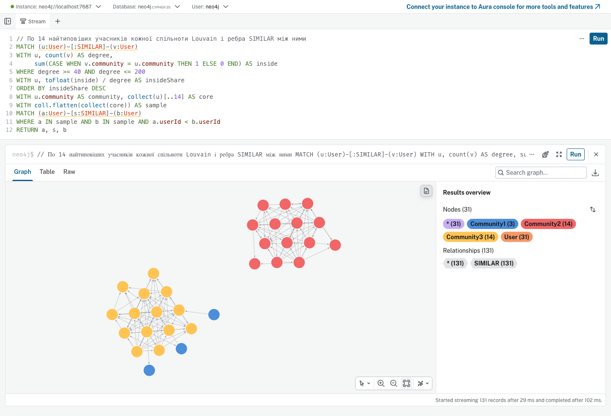

На скриншоті — по 14 найтиповіших учасників кожної спільноти (ті, в кого найбільша частка
зв'язків усередині своєї спільноти) і всі ребра між ними; кольори — тимчасові мітки
`Community1..3`. Червона (1736) і жовта (1273) спільноти — щільні групи; синя (4276) власного
щільного ядра серед рядових учасників не має.

#### 1. Чи відповідають кластери інтуїтивним групам?

Так, але з уточненнями.

- **Спільнота 1736 (239 користувачів) — любителі голлівудських блокбастерів 90-х.** Перебір
  бойовиків, пригод, фентезі й сімейного кіно (Action ×1.17, Adventure ×1.15, Children's ×1.26),
  удвічі менше документального кіно і нуару. Типові фільми — Lethal Weapon 4, The Saint, Hook,
  Executive Decision. Це наймолодша група, і фільми в неї найновіші.
- **Спільнота 1273 (190 користувачів) — поціновувачі класики й авторського кіно.** Перебір
  документальних фільмів (×1.82), нуару (×1.38) і драми, нестача бойовиків і фантастики
  (Action ×0.7, Sci-Fi ×0.75). Типові фільми — The Best Years of Our Lives (1946), The 39 Steps
  (1935), Top Hat (1935), Badlands, Klute. Найстарша група з найстаршими фільмами.
- **Спільнота 4276 (792 користувачі) — не «смак», а «всі інші».** Усі коефіцієнти близькі до 1,
  а серед характерних фільмів лише загальновизнані хіти з lift < 1. За будовою це зірка:
  кілька надактивних користувачів-хабів і 161 «листок» з одним ребром. Об'єднує цих людей не
  спільний смак, а зв'язок з одними й тими самими хабами.

Тобто дві з трьох спільнот — це впізнавані «любителі бойовиків» і «цінителі класики», третя —
мейнстрим. Розділення при цьому слабке: modularity лише 0.16, а в обох «смакових» спільнотах
близько половини зв'язків веде назовні (`avgInsideShare` 0.57 і 0.53). Четверта група, що з'являється
лише в частині паралельних запусків (70–106 користувачів), — це шанувальники американського
незалежного кіно 90-х (Kids, Bottle Rocket, Hard Eight, Requiem for a Dream): вона то виділяється
окремо, то розчиняється в трьох інших.

#### 2. Як я це перевірив?

Чотирма незалежними способами, жоден з яких алгоритм не бачив:

1. **Жанри відносно бази (lift), а не абсолютні топ-3** — абсолютний топ однаковий у всіх
   і нічого не показує.
2. **Найхарактерніші фільми кожної спільноти** — конкретні назви найкраще показують, чи група
   осмислена.
3. **Демографія і роки фільмів.** Louvain бачив лише ваги ребер, але у «блокбастерної» спільноти
   середня вікова група починається з 26 років і середній рік фільму 1988, а в «класичної» —
   33 роки і 1983 рік. Зовнішні ознаки узгоджуються з тлумаченням.
4. **Стійкість і якість розбиття**: повторні запуски (дві «смакові» спільноти з'являються
   завжди, четверта — через раз) і modularity.

Обмеження: вага «кількість спільних фільмів» не нормована, тому в граф потрапили тільки
найактивніші 20% користувачів. Щоб кластеризувати всіх, схожість треба нормувати (Жаккар чи
косинус, наприклад через `gds.nodeSimilarity`) і брати для кожного користувача k найближчих
сусідів, а не глобальний топ пар.

### 5.3. Найкоротший шлях між користувачами (Dijkstra)

```cypher
UNWIND [[4277, 4344], [2918, 3715], [6011, 3610], [5981, 3796], [3610, 3796], [5981, 6001]] AS pair
MATCH (source:User {userId: pair[0]})
MATCH (target:User {userId: pair[1]})
CALL gds.shortestPath.dijkstra.stream('userSimilarity', {
  sourceNode: source,
  targetNode: target,
  relationshipWeightProperty: 'cost'
})
YIELD totalCost, nodeIds, costs
WITH pair, totalCost, costs, [id IN nodeIds | gds.util.asNode(id).userId] AS path
RETURN pair, path,
       size(path) - 1 AS hops,
       size(path) - 2 AS intermediateUsers,
       [i IN range(1, size(costs) - 1) | toInteger(round(1.0 / (costs[i] - costs[i - 1])))] AS commonMovies,
       round(totalCost, 4) AS totalCost;
```

- Дейкстра мінімізує суму ваг, а `weight` — це *схожість* (що більше, то ближче). Якби передати
  її як є, алгоритм шукав би ланцюжок найменш схожих людей. Тому вагою слугує
  `cost = 1 / weight`: ребро між користувачами з 500 спільними фільмами «коротше» за ребро
  зі 120.
- `UNWIND` списку пар запускає алгоритм для кількох пар одним запитом; пари підібрано різні —
  два хаби, користувачі з різних спільнот і «листки» з одним ребром.
- `commonMovies` відновлює з накопичених вартостей кількість спільних фільмів на кожному кроці.

```
pair          path                      hops  intermediateUsers  commonMovies     totalCost
[4277, 4344]  [4277, 4344]                 1                  0  [518]               0.0019
[2918, 3715]  [2918, 4277, 3715]           2                  1  [196, 145]          0.0120
[6011, 3610]  [6011, 4277, 3610]           2                  1  [130, 124]          0.0158
[5981, 3796]  [5981, 4169, 5100, 3796]     3                  2  [131, 479, 120]     0.0181
[3610, 3796]  [3610, 4277, 5100, 3796]     3                  2  [124, 485, 120]     0.0185
[5981, 6001]  [5981, 4169, 4277, 6001]     3                  2  [131, 734, 121]     0.0173
```

Проміжних користувачів — від нуля до двох, і майже завжди це ті самі хаби: 4277, 4169, 5100.

Розподіл довжин найкоротших шляхів між **усіма** парами користувачів графа схожості
(`gds.allShortestPaths.stream`, у хопах):

```
hops   pairs    pct   avgPathLength
1      50000    6.7           1.945
2     685767   92.1           1.945
3       9043    1.2           1.945
```

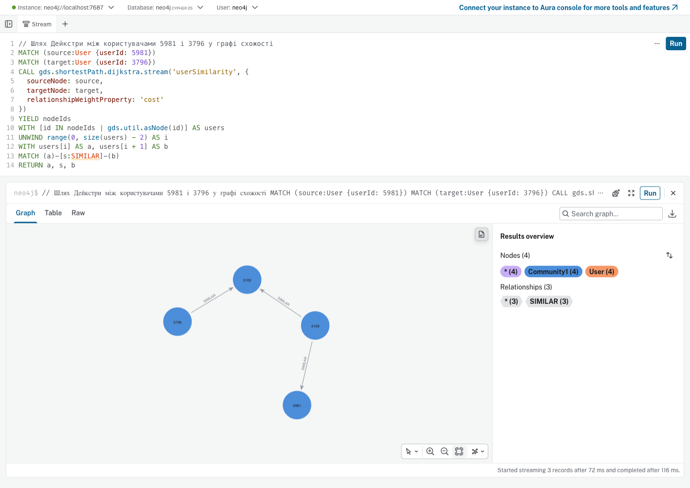

#### 1. Наскільки «тісний світ» у цьому датасеті?

Дуже тісний. Серед 1 221 користувача графа схожості будь-які двоє з'єднані щонайбільше за
3 кроки, а 92% пар — рівно за 2. Причина — хаби: користувач 4277 (1 743 оцінки) напряму пов'язаний
із 1 197 з 1 220 інших, тобто майже кожен шлях «A → хаб → B» має довжину 2. Найдовші шляхи
(3 кроки) — це пари «листків», які прив'язані до різних хабів.

#### 2. Яка середня довжина шляху? Чи підтверджується гіпотеза «шести рукостискань»?

Середня довжина — **1,945 кроку**, максимальна — 3. Гіпотеза «шести рукостискань» підтверджується
з великим запасом: вистачає трьох.

Два застереження. Перше: це граф лише 50 000 найсильніших зв'язків між найактивнішими
користувачами; 4 819 користувачів у ньому ізольовані, і для них шляхів немає взагалі — це ефект
відсікання, а не реальна ізоляція. Друге: на повному графі «користувач–фільм» світ ще тісніший —
запит 6c показує, що від користувача 1 до будь-кого вистачає одного-двох спільних фільмів.
Такий результат типовий для графів зі супервузлами: кілька хабів стягують увесь граф до
діаметра 2–3.

## Частина 6 — аналіз і висновки

### 1. Граф vs SQL

Для порівняння візьмемо очевидну реляційну схему: `users(user_id, …)`, `movies(movie_id, title, year)`,
`genres(genre_id, name)`, `movie_genres(movie_id, genre_id)`, `ratings(user_id, movie_id, rating, ts)`.

**Запити 1–4 в SQL пишуться легко** — це з'єднання плюс `GROUP BY`, і вони не довші за Cypher.
Запит 3, наприклад, — одне самоз'єднання таблиці оцінок:

```sql
SELECT m.title, r1.rating, r2.rating
FROM ratings r1
JOIN ratings r2 ON r2.movie_id = r1.movie_id
JOIN movies  m  ON m.movie_id  = r1.movie_id
WHERE r1.user_id = 1 AND r2.user_id = 2 AND r1.rating >= 4 AND r2.rating >= 4;
```

**Запит 5 (рекомендації) написати можна, але він помітно важчий** — три CTE і п'ять з'єднань,
два з яких — самоз'єднання мільйонної таблиці оцінок:

```sql
WITH liked AS (                          -- оцінки 4-5
    SELECT user_id, movie_id, rating FROM ratings WHERE rating >= 4
),
liked_cnt AS (                           -- скільки фільмів уподобав кожен
    SELECT user_id, COUNT(*) AS n FROM liked GROUP BY user_id
),
neighbours AS (                          -- 30 найсхожіших за Жаккаром
    SELECT o.user_id,
           COUNT(*)::float / (me_cnt.n + o_cnt.n - COUNT(*)) AS similarity
    FROM liked me
    JOIN liked o          ON o.movie_id = me.movie_id AND o.user_id <> me.user_id
    JOIN liked_cnt me_cnt ON me_cnt.user_id = me.user_id
    JOIN liked_cnt o_cnt  ON o_cnt.user_id  = o.user_id
    WHERE me.user_id = 1
    GROUP BY o.user_id, me_cnt.n, o_cnt.n
    HAVING COUNT(*) >= 5
    ORDER BY similarity DESC
    LIMIT 30
)
SELECT m.title, m.year,
       COUNT(*)                             AS neighbours,
       ROUND(AVG(l.rating), 2)              AS avg_rating,
       ROUND(SUM(n.similarity)::numeric, 3) AS score
FROM neighbours n
JOIN liked  l ON l.user_id  = n.user_id
JOIN movies m ON m.movie_id = l.movie_id
WHERE NOT EXISTS (SELECT 1 FROM ratings r
                  WHERE r.user_id = 1 AND r.movie_id = l.movie_id)
GROUP BY m.movie_id, m.title, m.year
HAVING COUNT(*) >= 3
ORDER BY score DESC, avg_rating DESC
LIMIT 10;
```

Запит існує і з індексами `(user_id, movie_id)` та `(movie_id, user_id)` працюватиме прийнятно.
Різниця в тому, як він читається і виконується. У Cypher патерн
`(me)-[:RATED]->(m)<-[:RATED]-(other)` буквально малює обхід, і кожен крок — це перехід за
вказівником від уже знайденого вузла. У SQL кожен крок — з'єднання, яке шукає пару в індексі
всієї таблиці, а сам «маршрут» доводиться відновлювати з умов `ON`. Що довший ланцюжок, то
більша різниця.

**Запит 6 (найкоротший шлях) — найскладніший, і саме тут SQL фактично здається.** Довжина шляху
наперед невідома, тому фіксованою кількістю з'єднань не обійтися: для шляху довжини 2 потрібне
одне самоз'єднання, для довжини 4 — три, і під кожну довжину це окремий запит. Універсальний
варіант — рекурсивний CTE (синтаксис PostgreSQL):

```sql
WITH RECURSIVE chain AS (
    SELECT 1 AS user_id, ARRAY[1] AS users, ARRAY[]::int[] AS movies
  UNION ALL
    -- один крок рекурсії = два ребра: користувач -> фільм -> наступний користувач
    SELECT r2.user_id, c.users || r2.user_id, c.movies || r1.movie_id
    FROM chain c
    JOIN ratings r1 ON r1.user_id  = c.user_id
    JOIN ratings r2 ON r2.movie_id = r1.movie_id
    WHERE c.user_id <> 46                   -- дійшли до цілі — далі не йдемо
      AND r2.user_id <> ALL (c.users)       -- захист від циклів
      AND cardinality(c.movies) < 5         -- обмеження глибини (10 ребер)
)
SELECT users, movies, 2 * cardinality(movies) AS hops
FROM chain
WHERE user_id = 46
ORDER BY hops
LIMIT 1;
```

Формально це той самий запит, але на практиці він не виконається:

- **Рекурсивний CTE перебирає всі маршрути, а не всі вузли.** Він не знає, що до користувача вже
  дійшли коротшим шляхом, і тягне кожен маршрут окремим рядком із власним масивом пройдених
  вузлів. Для користувача 1 це 60 146 рядків після першого кроку (хоча різних користувачів серед
  них лише 5 899) і **13,9 мільярда** після другого — а шлях до користувача 46 знаходиться саме
  на другому кроці. `shortestPath` у Neo4j для тієї самої пари відвідує кожен вузол щонайбільше
  один раз (вузлів у графі менше 10 тисяч) і відповідає за мілісекунди.
- **Немає ранньої зупинки.** `ORDER BY hops LIMIT 1` застосовується вже після того, як рекурсія
  побудувала всі маршрути до заданої глибини. Двонапрямний пошук у ширину, який зупиняється
  на першій зустрічі двох фронтів, декларативно в SQL не виражається.
- **Обхід циклів і сам ланцюжок — ручна робота**: масиви `users` і `movies`, перевірка
  `<> ALL`, обмеження глибини. Якщо відмовитися від масивів і лишити тільки `(user_id, depth)`
  з `UNION`, вийде пошук у ширину за рівнями, який виконається, але поверне лише *довжину*
  шляху, без самого ланцюжка.

Показово, що стандарт SQL:2023 додав окреме розширення SQL/PGQ із графовими патернами, тобто
визнав, що чистими з'єднаннями й рекурсією такі запити формулюються погано.

Підсумок: що більше запит схожий на «пройди ланцюжком зв'язків невідомої довжини», то більша
перевага графа. Фільтрації й агрегації (запити 1–4) однаково зручні в обох моделях.

### 2. Де граф програє

**Глобальні агрегації по всіх даних.** Запити 2 і 4 не мають вибіркової точки входу й мусять
пройти всі оцінки, і тут граф гірший за реляційну базу. Запит 4 (середня оцінка за жанрами)
у Neo4j — це 6,3 млн звернень до сховища і близько 1,6 с: кожну оцінку база дістає переходом
за вказівником, рядок за рядком. Реляційна (тим паче колонкова) СУБД виконає
`SELECT g.name, AVG(r.rating) … GROUP BY g.name` послідовним скануванням двох колонок і одним
hash join. Індекс-вільна суміжність дає виграш, коли читаємо малу околицю графа, і стає тягарем,
коли читаємо все.

**Звіти.** «Топ-3 фільми в кожному жанрі», «середня оцінка за жанром і віковою групою у вигляді
зведеної таблиці», «кількість оцінок по місяцях із ковзним середнім» — у SQL це віконні функції
(`ROW_NUMBER() OVER (PARTITION BY …)`), `ROLLUP`/`CUBE`, `date_trunc`. У Cypher віконних функцій
немає; те саме доводиться збирати через `collect()` і зрізи списків, і на великих групах це
і незручно, і дорого по пам'яті.

**Експорт і масові операції.** Вивантажити всі оцінки в CSV чи Parquet, перерахувати колонку для
мільйона рядків, з'єднати з довідником із зовнішнього файла — для реляційної бази це одна команда
(`COPY`, `UPDATE … FROM`). У Neo4j потрібні APOC і транзакції батчами, а невдало написаний запит
легко вичерпує пам'ять: у частині 5 самоз'єднання оцінок «у лоб» впало з нестачею пам'яті
транзакції, тоді як реляційна СУБД скинула б проміжну агрегацію на диск.

**Щільність зберігання.** Оцінка — це чотири цілих числа. CSV з мільйоном оцінок займає 23 МБ,
а сховище Neo4j після завантаження — близько 129 МБ (окремі файли для записів ребер, властивостей
і вузлів з усіма вказівниками). Для табличних даних «факт із кількома числами» рядок у таблиці
набагато компактніший.

**Цілісність даних.** У SQL обмеження `PRIMARY KEY (user_id, movie_id)`,
`CHECK (rating BETWEEN 1 AND 5)` і зовнішні ключі гарантує сама база. У Neo4j Community є лише
обмеження унікальності; унікальність пари «користувач–фільм» тримається на дисципліні `MERGE`,
а обмеження на обов'язковість і тип властивостей доступні тільки в Enterprise.

**Екосистема.** BI-інструменти, pandas, dbt та більшість аналітичних конвеєрів розмовляють SQL.

Тому в реальній системі на цих даних я б тримав оцінки в реляційній або колонковій базі як
джерело правди для звітів і статистики, а граф використовував би як спеціалізований індекс для
обходів: рекомендацій, шляхів, спільнот.

### 3. Покращення схеми

Три зміни схеми виміряно в [`queries/part6_improvements.cypher`](queries/part6_improvements.cypher):
для кожної `PROFILE` базового запиту з частини 3, зміна схеми, `PROFILE` нового варіанта.
Результати запитів до і після однакові. DbHits — кількість звернень до сховища (детермінована),
час — одиничний замір, наведений для орієнтиру.

| Запит | Зміна схеми | DbHits до | DbHits після | Виграш | Час до → після |
|---|---|---:|---:|---:|---|
| 1 (трилери з рейтингом > 4.0) | агрегати `ratingCount`, `ratingSum`, `avgRating` на `Movie` | 571 590 | 1 203 | 475× | 171 → 42 мс |
| 4 (статистика жанрів, без `stdDev` і `pctHigh`) | ті самі агрегати | 6 336 793 | 60 919 | 104× | 1 585 → 59 мс |
| 5 (рекомендації) | окремий тип ребра `LIKED` для оцінок ≥ 4 | 2 214 593 | 183 317 | 12× | 512 → 337 мс |
| 2 (понад 50 оцінок «5») | індекс на властивості ребра `RATED(rating)` | 2 248 951 | 678 941 | 3,3× | 591 → 211 мс |

**Запити 1 і 4 — агрегати на вузлі `Movie`.**

```cypher
MATCH (m:Movie)
OPTIONAL MATCH (m)<-[r:RATED]-(:User)
WITH m, count(r) AS ratingCount, sum(r.rating) AS ratingSum
SET m.ratingCount = ratingCount,
    m.ratingSum   = ratingSum,
    m.avgRating   = CASE WHEN ratingCount > 0 THEN toFloat(ratingSum) / ratingCount END;

MATCH (:Genre {name: 'Thriller'})<-[:HAS_GENRE]-(m:Movie)
WHERE m.avgRating > 4.0
RETURN m.title AS title, m.year AS year, round(m.avgRating, 2) AS avgRating, m.ratingCount AS ratings
ORDER BY avgRating DESC, ratings DESC;
```

Базовий запит 1 заради 52 рядків читає 189 680 оцінок усіх трилерів; із готовими агрегатами
він читає 492 вузли фільмів і жодного ребра `RATED`. Запит 4 так само зводиться до 6 408 ребер
`HAS_GENRE`: середнє жанру — це сума `ratingSum`, поділена на суму `ratingCount`. Зберігати треба
саме суму й кількість, а не лише середнє, бо середні не можна усереднювати; для `stdDev`
і `pctHigh` довелося б додати ще суму квадратів і кількість високих оцінок.
Ціна: кожна нова оцінка тепер ще й оновлює вузол фільму, тобто записи в популярні фільми
конкурують за один вузол (або агрегати перераховуються фоновим завданням і трохи відстають).

**Запит 5 (і запит 3) — тип ребра `LIKED`.**

```cypher
MATCH (u:User)-[r:RATED]->(m:Movie)
WHERE r.rating >= 4
CALL (u, m, r) {
  MERGE (u)-[l:LIKED]->(m)
  SET l.rating = r.rating
} IN TRANSACTIONS OF 10000 ROWS;
```

У базовому запиті 5 умова `rating >= 4` перевіряється в п'яти місцях, і щоразу для цього читається
властивість кожного ребра; найдорожча частина — підрахунок уподобаних фільмів для кожного
кандидата в сусіди. З окремим типом ребра фільтр зникає, а
`COUNT { (other)-[:LIKED]->() }` взагалі не перебирає ребра — бере готовий лічильник ребер
цього типу. Результат: у 12 разів менше звернень. Запит 3 спрощується так само:
`(u1)-[:LIKED]->(m)<-[:LIKED]-(u2)` без `WHERE`. Ціна: 575 281 додаткове ребро (+57%)
і необхідність тримати `LIKED` узгодженим з `RATED` при зміні оцінки.

**Запит 2 — індекс на властивості ребра.**

```cypher
CREATE INDEX rated_rating IF NOT EXISTS
FOR ()-[r:RATED]-() ON (r.rating);
```

Без індексу запит переглядає весь мільйон оцінок і відкидає 77% із них; з індексом планувальник
одразу бере з нього 226 310 ребер з оцінкою «5». Виграш скромніший (3,3×), бо оцінка «5» —
це майже чверть усіх ребер, тобто індекс тут маловибірковий. Ще радикальніший варіант —
зберігати лічильник `fiveCount` на вузлі `User`: тоді запит читає лише 6 040 вузлів.

**Запит 6** прискорювати не треба (він і так відповідає за мілісекунди), але та сама зміна
покращила б його *зміст*: шлях `-[:LIKED*..10]-` з'єднує людей через фільми, які обом
сподобалися, а не просто через спільно переглянуті блокбастери.

Усі три покращення — це денормалізація: швидше читання в обмін на дорожчий і складніший запис.
Базову схему з частини 1 я залишив нормалізованою, бо для навчального датасету, який
завантажується один раз, простота важливіша; скрипт експериментів наприкінці повертає граф
до цієї схеми.

## Джерело даних

F. Maxwell Harper and Joseph A. Konstan. 2015. The MovieLens Datasets: History and Context.
ACM Transactions on Interactive Intelligent Systems (TiiS) 5, 4, Article 19 (December 2015), 19 pages.
DOI: <https://doi.org/10.1145/2827872>
